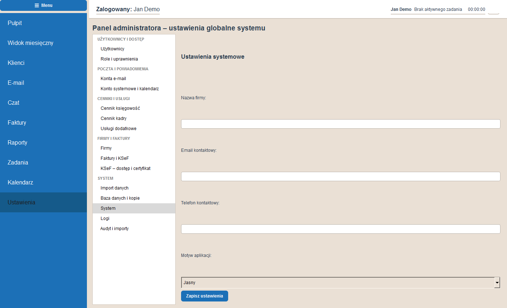

# Biuro – program dla biura rachunkowego

Aplikacja desktopowa (PyQt6 + PostgreSQL) do prowadzenia biura rachunkowego: klienci, faktury, e-mail, kalendarz, zadania, raporty i kontrola kopii zapasowych.

> Zrzuty ekranu pochodzą z tymczasowej bazy z danymi fikcyjnymi (`scripts\make_screenshots.py`).

## Moduły

| Moduł | Opis |
|---|---|
| **Pulpit** | Podsumowanie dnia, czas pracy, stan kopii zapasowych |
| **Widok miesięczny** | Status firm w wybranym miesiącu (wybór miesiąca i roku) |
| **Klienci** | Lista firm, formularz firmy, pełnomocnictwa (PEL/UPL), data ostatniej kopii bazy |
| **E-mail** | Wiele kont IMAP/SMTP, foldery, reguły, etykiety, przypisywanie wiadomości do firm |
| **Czat** | Wewnętrzna komunikacja pracowników |
| **Faktury** | Wystawianie z cennika, usługi dodatkowe, KSeF, eksport XLSX do Saldeo |
| **Raporty** | Import dokumentów i czasu pracy, rentowność, czas według klienta i pracownika |
| **Zadania** | Zadania z czasomierzem |
| **Kalendarz** | Wydarzenia, import ICS, synchronizacja CalDAV |
| **Ustawienia** | Panel administratora (poniżej) |

## Zrzuty ekranu


### Panel administratora

| | |
|---|---|
|  |  |
|  |  |
|  |  |
|  |  |
|  |  |
|  |  |
|  |  |

## Kopie zapasowe

Program czyta logi kopii (Cobian Backup, mail „Backup 11 (ENOVA)”) z pliku albo z najnowszego maila na koncie systemowym. Nazwy plików mają postać `firma_datautworzenia` (np. `Firma_20261021.BAK`), z której pobierana jest data.

**Ustawienia → Baza danych i kopie → „Sprawdź z ostatniego maila”** pobiera najnowszy mail, zapisuje datę ostatniej kopii w firmach i pokazuje tabelę *Nazwa firmy | Data | Błąd (TAK/NIE)*. Data jest widoczna w kolumnie „Ostatni backup” na liście klientów.

## Wymagania

- Python 3.11
- PostgreSQL
- Zależności: `pip install -r requirements.txt`

## Konfiguracja

Skopiuj `.env.example` jako `.env` (katalog projektu albo `%LOCALAPPDATA%\Biuro\` dla wersji zainstalowanej). Plik `.env` nie trafia do instalatora ani do repozytorium.

| Zmienna | Opis |
|---|---|
| `DB_URL` | Adres bazy PostgreSQL (wymagane) |
| `BIO_ENCRYPTION_KEY` | Klucz szyfrowania haseł kont e-mail; przy bazie na NAS ustaw ten sam na wszystkich komputerach |
| `CEIDG_BASE_URL`, `CEIDG_API_KEY` | Wyszukiwanie firm w CEIDG |
| `GUS_API_URL`, `GUS_API_KEY` | Wyszukiwarka REGON (domyślny adres jest wbudowany) |

## Uruchomienie

```powershell
pip install -r requirements.txt
python migrate_db.py   # tworzy/aktualizuje schemat bazy
python main.py
```

`migrate_db.py` kończy się sukcesem tylko wtedy, gdy schemat jest aktualny (`SCHEMA_VERSION` w `app\db\schema.py`). Zmiana struktury bazy wymaga podbicia tej wersji.

## Poczta i powiadomienia

Pełne pobieranie uruchamia się **wyłącznie ręcznie** w **Ustawienia → Moje
ustawienia → Synchronizacja poczty**. Wybierz jedno konto albo **Wszystkie
dostępne konta** i użyj **Pobierz pełne wiadomości z 2 lat**. Każdy użytkownik
może pobierać swoje przypisane konta; administrator ma dostęp do wszystkich
kont. Opcja jest także dostępna dla wybranego konta w administracyjnych
ustawieniach poczty.

Pobieranie działa w tle i zapisuje pełne wiadomości wraz z załącznikami z
ostatnich 730 dni ze wszystkich wybieralnych folderów. Można pracować w innych
modułach lub zminimalizować okno. Po przerwaniu uruchom opcję w ustawieniach
ponownie — zapisane już wiadomości zostaną pominięte. Otwarcie aplikacji ani
nieukończona poprzednia synchronizacja nie uruchamiają pełnego pobierania.
Postęp pokazuje folder, liczbę sprawdzonych wiadomości i czas działania.

Później program sprawdza nowe wiadomości co dwie minuty we wszystkich folderach.
Różne konta synchronizują się niezależnie; operacje jednego konta są kolejkowane,
a nie uruchamiane równocześnie. Nieudane odświeżenie folderów nie usuwa lokalnej
poczty. Obok pełnego nazwiska pracownika jest liczba przypisanych mu
nieprzeczytanych wiadomości na wybranym koncie. Liczniki przypisań są odświeżane
co 15 sekund oraz po odczytaniu/przypisaniu wiadomości.

Przycisk **Powiadomienia** w nagłówku pokazuje przypisane e-maile i otwarte
zadania. Kliknięcie przenosi do wiadomości lub zaznacza zadanie na liście.
Stan odczytania powiadomień jest zapisywany dla użytkownika na tym komputerze;
oznaczenie powiadomienia jako odczytane nie kończy zadania ani nie oznacza
wiadomości e-mail jako przeczytanej.

## Rozliczenia i KSeF

### Wygląd i katalog usług

Każdy użytkownik ma dostęp do **Ustawienia → Moje ustawienia → Wygląd**.
Można wybrać jasny lub ciemny motyw oraz kolor akcentu. Zmiany działają od razu
i są zapisywane osobno dla każdego konta na danym komputerze. Ustawienia
administracyjne nadal wymagają odpowiednich uprawnień.

Podczas wystawiania faktury przycisk **Dodaj z katalogu usług** otwiera
wyszukiwalną listę usług dodatkowych. W zakładce roboczych faktur pozycje
edytuje się bezpośrednio w dolnej tabeli: nazwa, ilość, jednostka, cena netto,
VAT i kategoria. W tym samym panelu można zapisać daty wystawienia, sprzedaży,
termin płatności, przyczynę korekty i podstawę zwolnienia z VAT.
Zmiany pozycji zapisują się automatycznie, a wartości netto i brutto
są przeliczane. Obok tabeli można wybrać usługę z katalogu i jej ilość,
dodać nową pozycję lub usunąć wybraną.
Wybierz usługę i ilość; nazwa, cena netto i VAT są pobierane z katalogu.
Po dodaniu można edytować pozycję. Katalog jest zarządzany przez administratora
w **Ustawienia → Usługi dodatkowe**. Dodanie pozycji z katalogu nie tworzy
wpisu w ewidencji wykonanych czynności.

W formularzu nowego kontrahenta przycisk **Pobierz dane po NIP (GUS / CEIDG)**
uzupełnia dane firmy z rejestrów. Pobieranie działa w tle, wymaga konfiguracji
źródeł danych i nie zapisuje kontrahenta automatycznie. Dane można sprawdzić
i poprawić przed zapisaniem.

Pole **Zdrowotna wliczona do ceny** oznacza, że opłata jest już zawarta w cenie
księgowości: nie zwiększa ceny i nie tworzy osobnej pozycji zdrowotnej na fakturze.
Gdy pole jest odznaczone, zdrowotna jest naliczana osobno według konfiguracji.

### Uzgadnianie płatności

W **Fakturach wystawionych** przycisk **Rozlicz ING MT940** importuje wyciąg
do kolejki uzgodnień. Wybierz przelew, fakturę i kwotę, a następnie potwierdź
przypisanie. Można podzielić przelew na kilka faktur lub rozliczyć część salda.
Import nie zapisuje płatności automatycznie. Rozliczane są tylko wpływy w PLN;
storna i inne waluty pozostają poza listą wpłat do przypisania. Data zapłaty
pochodzi z daty księgowania, a przy jej braku z daty waluty.

**Zapłata gotówką** proponuje pozostałe saldo i pozwala wskazać rzeczywistą
datę otrzymania pieniędzy. Księgowy widok miesięczny pokazuje numer faktury
i datę pełnego rozliczenia przed „Kompletem”, dla faktur dotyczących wybranego
miesiąca. Szczegóły częściowych wpłat są dostępne w podpowiedzi komórki.

Pod pozycjami faktury oraz w PDF znajduje się podsumowanie według stawek VAT:
netto, podatek i brutto, z osobnym wierszem sumy.

Pobieranie i wysyłka KSeF wymagają certyfikatu i klucza prywatnego w ustawieniach;
token nie zastępuje certyfikatu. Zaznacz dokumenty i użyj **Wyślij zaznaczone do
KSeF** (wystawione) lub **Wystaw i wyślij do KSeF** (robocze). Numer faktury
można wcześniej uzupełnić i zapisać nad tabelą pozycji. Program generuje FA(3)
z danych faktury i sprawdza go lokalnie z dołączonym schematem XSD.
Po potwierdzeniu środowiska wysyłka i sprawdzanie przyjęcia działają w tle.
Po przyjęciu numer pojawia się w tabeli oraz podglądzie/PDF; przyjęty XML jest
pobierany do katalogu danych aplikacji `ksef/<środowisko>/<NIP>/<numer>.xml`.
Ponowne sprawdzanie i pobieranie nie wysyła faktury drugi raz. Stan niepewnej
wysyłki jest zachowywany również po zamknięciu programu. **Status wysyłki KSeF**
pozwala wznowić sprawdzanie, gdy automatyczne próby się zakończą.
Generator obsługuje krajowe faktury PLN oraz korekty, ze stawkami 23/22, 8/7,
5 i 0%; zwolnienie wymaga podania podstawy prawnej. Nieobsługiwane procedury
lub brakujące dane zatrzymują wysyłkę z komunikatem.

### Wysyłka PDF do klienta

W formularzu firmy sekcja **Faktury i ceny → Adres e-mail do wysyłki faktur**
pozwala wskazać adres rozliczeniowy, np. `invoices@firma.com`. Ma on pierwszeństwo
przed ogólnym adresem kontaktowym. Formularz firmy jest podzielony na zakładki,
a przyciski zapisu pozostają widoczne poza przewijaną treścią.

Zaznacz **Po przyjęciu w KSeF wyślij PDF do klienta** przed wysyłką dokumentów.
Program pokaże nadawcę i odbiorców do zatwierdzenia. Kolejność jest następująca:
przyjęcie w KSeF, nadanie numeru, pobranie i sprawdzenie XML, wygenerowanie PDF
z numerem i urzędowym QR, wysyłka z zatwierdzonego konta pocztowego. PDF powstaje
na podstawie przyjętego XML, a nie późniejszych zmian w kartotece. Adresaci są
utrwalani w kolejce. Przycisk **Wyślij PDF e-mailem** umożliwia wysyłkę również
faktur mających już numer KSeF. Stan wysyłki jest widoczny w tabeli faktur.
Niepewny wynik SMTP wymaga sprawdzenia; program nie ponawia automatycznie
wiadomości, która mogła już dotrzeć. Nowa wersja wymaga jednokrotnego uruchomienia
**Biuro – aktualizacja bazy** po instalacji.

**Pobierz z KSeF** pobiera sprzedażowe faktury VAT oraz korekty FA(3) z wybranego miesiąca.
Nabywca jest łączony z firmą po NIP-ie. Dokument o tym samym numerze KSeF lub
numerze faktury jest aktualizowany, a pojedynczy niezsynchronizowany dokument
tej firmy i miesiąca może zostać zastąpiony. Gdy dokumentu nie ma, program go
tworzy. Treść, daty, pozycje i kwoty pochodzą z KSeF; zapisane płatności
pozostają przy dotychczasowym ID faktury. Niepewny NIP lub kilka pasujących
faktur wymaga wyjaśnienia i nie powoduje automatycznego nadpisania. Po
synchronizacji program pokazuje takie dokumenty w osobnej tabeli. Firmę można
wyszukać po nazwie lub NIP-ie i przypisać ręcznie bez ponownego pobierania XML-a.
Synchronizacja najpierw pobiera i deduplikuje listę sprzedaży. XML-e już
zapisanych numerów KSeF są pomijane, dlatego po przerwaniu kolejne uruchomienie
wznawia pobieranie brakujących dokumentów. Przy ponad 10 brakujących
dokumentach program korzysta z zalecanego przez MF eksportu paczkowego
`/invoices/exports`, pobiera i weryfikuje skróty zaszyfrowanych części, a
następnie odszyfrowuje paczkę lokalnie. Dla mniejszej liczby respektuje pełny
`Retry-After` KSeF. Synchronizacja działa w tle i pokazuje liczbę znalezionych
oraz przetworzonych faktur, więc nie blokuje okna programu.

W tabeli wystawionych faktur numer faktury i przycisk **Podgląd** otwierają
lokalny widok dokumentu z pełnymi danymi sprzedawcy i nabywcy, pozycjami,
kodem QR oraz opcją **Zapisz PDF**. Dane sprzedawcy i logo ustawia się w
**Ustawieniach faktur**. Podgląd wypełnia szerokość okna, a zapis PDF korzysta
z pionowej strony A4. Techniczna kolumna ID jest ukryta. XSD FA(3)
służy do walidacji danych, a wygląd podglądu generuje program. Kliknięcie
numeru KSeF otwiera urzędowy adres weryfikacyjny z NIP-em sprzedawcy, datą
wystawienia i skrótem XML, jeżeli zostały zapisane podczas wysyłki lub pobrania.
Starszy dokument bez tych danych zostanie uzupełniony przy kolejnej
synchronizacji KSeF; do tego czasu otworzy się formularz wyszukiwania.
Miesiąc dokumentu KSeF zawsze wynika z daty wystawienia; migracja naprawia też
starsze wpisy zapisane w innym miesiącu. W Fakturach i Widoku miesięcznym miesiąc
wybiera się tym samym małym kalendarzem z przyciskami miesięcy i zmianą roku.

## Czynności dodatkowe i kolejne faktury

Zakładka **Czynności dodatkowe** w Zadaniach (dostępna także z Faktur) pokazuje
czynności według klienta, miesiąca i stanu. Można utworzyć czynność razem
z zadaniem albo powiązać ją z istniejącym zadaniem tej samej firmy. Wykonanie
wynika ze statusu zadania; planowane i anulowane czynności nie są fakturowane.

Zwykłe **Generuj faktury** po wystawieniu faktury podstawowej tworzy kolejną
fakturę tylko za nowe, jeszcze nieujęte czynności dodatkowe. Działa to również
po wystawieniu wcześniejszych faktur dodatkowych. Ponowne generowanie korzysta
z istniejącego szkicu i nie nalicza ponownie tych samych czynności.

Nowe pozycje kadrowe mają nazwy „Usługa kadrowo-płacowa – UZ”,
„Usługa kadrowo-płacowa – UoP”, „Usługa płacowa – UZ” lub
„Usługa płacowa – UoP”, zgodnie z wybranym zakresem cennika. Stała opłata
ma nazwę „Usługa kadrowo-płacowa”. Wystawione dokumenty zachowują swoje nazwy.

Korekty nie są eksportowane jako zwykłe faktury z ujemnymi pozycjami.
Przycisk **Korekta w Saldeo** pokazuje dane faktury pierwotnej i zmiany
do wprowadzenia w Saldeo. Po rzeczywistym wystawieniu korekty można zapisać
jej numer w programie, potwierdzając ten fakt. Korekty wystawione w KSeF są
importowane przez **Pobierz z KSeF** i, gdy numer faktury pierwotnej jest
jednoznaczny, zostają z nią powiązane. Ścieżka Saldeo nie importuje korekty
automatycznie i nie zmienia znaków wartości.

W imporcie ING pola opisu przelewu, nadawcy, referencji i rachunku są odrębne.
Przy niepoprawnych polskich znakach wybierz kodowanie pliku (UTF-8,
Windows-1250, ISO-8859-2 lub CP852); program pamięta wybór. Rozpoznany numer
faktury, NIP, rachunek lub jednoznaczna nazwa kontrahenta zawęża jego faktury,
również z wcześniejszych miesięcy. Opcja **Wszystkie faktury** pozwala wybrać
inny dokument ręcznie. Samo dopasowanie nie zapisuje płatności.
Pole rozpoznanego kontrahenta jest edytowalną listą: można wpisać fragment
nazwy, wybrać właściwego klienta i ograniczyć listę faktur do niego. Automatyczne
rozpoznanie pozostaje wyłącznie propozycją do ręcznego potwierdzenia.

Przegląd możliwości użycia bibliotek: [docs/library-review.md](docs/library-review.md).

## Testy

```powershell
python run_tests.py                      # wszystkie pliki testowe
python -m unittest tests.test_invoices   # pojedynczy plik
```

Każdy test działa na osobnym, tymczasowym schemacie PostgreSQL.

## Zrzuty ekranu do dokumentacji

```powershell
python scripts\make_screenshots.py
```

Skrypt tworzy tymczasowy schemat z fikcyjnymi firmami, zapisuje obrazy w `docs\screenshots` i usuwa schemat. Dane z prawdziwej bazy nie są odczytywane; zakładka „Logi” jest pomijana.

## Instalator

Skrypt Inno Setup: `installer\biuro.iss` (wersja 1.3.1). Specyfikacja PyInstallera: `packaging\biuro.spec` (opis w `packaging\README.md`).

## Struktura

```
app\            kod aplikacji (admin, companies, dashboard, db, email, invoices, kalendarz, monthly_view, reports, tasks, utils ...)
tests\          testy unittest
scripts\        narzędzia pomocnicze
installer\      instalator Inno Setup
docs\screenshots\  zrzuty ekranu do README
```
