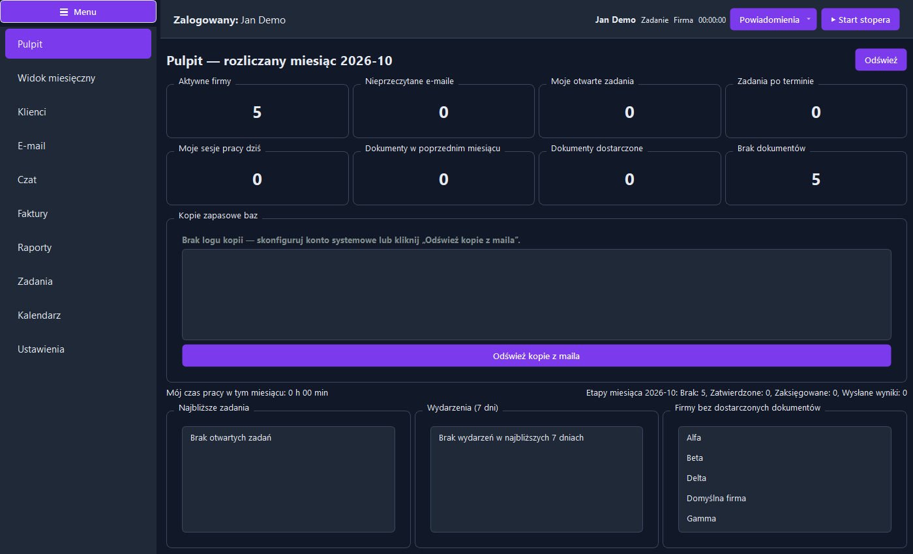

# Biuro

Biuro to aplikacja Windows dla biura rachunkowego. Łączy kartotekę firm, widok miesięczny, kontrolę deklaracji, faktury i rozliczenia bankowe z pocztą, zadaniami, kalendarzem i raportami czasu pracy. Stanowiska pracowników łączą się przez HTTPS ze wspólną usługą Biuro.



## Instalacja i aktualizacja

| Miejsce | Co działa |
| --- | --- |
| Stanowisko pracownika | Klient Biuro, adres HTTPS usługi i konto pracownika |
| Serwer workera, np. VM Enova | Usługa HTTPS, zadania w tle i połączenia z systemami zewnętrznymi |
| Serwer bazy, np. VM Biuro | Wspólna baza PostgreSQL |
| VM Płatnik | Źródłowa baza SQL Server programu Płatnik |

1. Pobierz pakiet `Biuro-Windows-installer` z zakończonego zadania **windows-release** i uruchom `Biuro-Setup-<wersja>.exe`. Na stanowiskach wybierz **Program Biuro**. Na serwerze wybierz składnik workera. [Pakiety z GitHub Actions](https://github.com/Pawel-Sokolowski/Biuro/actions/workflows/tests.yml)
2. Na serwerze ustaw adres PostgreSQL oraz wspólny klucz Biuro w panelu `Biuro.exe --worker-setup`. Worker przechowuje konfigurację pod kontem Windows, na którym działa. Przy aktualizacji użyj dotychczasowego klucza. [Konfiguracja workera](docs/worker-configuration.md)
3. W panelu workera włącz usługę HTTPS i ustaw certyfikat odpowiadający adresowi używanemu na stanowiskach. Przy połączeniu na adres IP certyfikat musi zawierać ten adres IP w polu SAN. Domyślny port usługi to `8443`. [Połączenie stanowisk z serwerem](docs/office-server.md)
4. Uruchom Biuro na stanowisku, podaj adres HTTPS workera i zaloguj się kontem pracownika. Przy kompilacji instalatora parametr `DefaultServerUrl` może uzupełnić adres na nowych stanowiskach. Adres zapisany wcześniej przez użytkownika ma pierwszeństwo. [Budowanie instalatora](packaging/README.md)

### Migracja PostgreSQL

`python migrate_db.py` wykonuje oczekujące migracje Alembic w bazie wskazanej przez `DB_URL`. Można uruchomić go z dowolnego komputera z bezpośrednim dostępem do tej bazy i odpowiednimi uprawnieniami. Zainstalowany worker udostępnia `Biuro.exe --worker-migrate`, które korzysta z konfiguracji workera. Przy kolejnych aktualizacjach schematu kod migracji znajduje się w `app/db/migrations/versions`.

Przed aktualizacją schematu zachowaj kopię PostgreSQL i klucz Biuro oraz sprawdź procedurę odzyskania. [Kopia zapasowa i odtworzenie](docs/database-recovery.md)

Migracja `20261121_02` przenosi historię Sprawdzania i oczekujące odczyty do indeksowanych tabel PostgreSQL. Zachowuje daty JPK i UPO, zaznaczenia deklaracji oraz szyfrowanie raportów Płatnika. Na czas tej migracji zatrzymaj usługę HTTPS i zadania workera, które korzystają ze wspólnej bazy. Po migracji uruchom zaktualizowanego workera.

Migracja `20261121_03` dodaje indeksy dla kolejki MT940, rozpoznawania rachunków własnych, faktur według miesiąca i wyszukiwania firmy po znormalizowanym NIP.

Migracja `20261121_05` dodaje indeks wyszukiwania faktur po numerze w MT940 oraz zapisuje terminy ponowień odczytów Enovy.

Migracja `20261121_06` zapisuje zatwierdzone przez administratora powiązania kartotek Płatnika.

## Sprawdzanie i deklaracje

- **Enova365.** Zmiana etapu na **Wysłane wyniki** zleca odczyt dokumentów dla danej firmy i miesiąca. Reguły licznika zależą od KPiR, ksiąg handlowych lub ryczałtu i statusu VAT. KPiR i ryczałt mają zestawienie **Sprzedaż | Zakup | DW | Razem**. Raporty kasowe podlegają ustawionemu dzielnikowi, a LT i OT są wyłączone z licznika środków trwałych. [Reguły i konfiguracja Enova](docs/enova/README.md)
- **JPK.** Sprawdzanie pokazuje status, datę wysłania i odrębną datę UPO w zakresie danych zwracanych przez Enovę. Pobranie statusu służy kontroli deklaracji. [Kontrakt odczytu Enova](docs/enova/README.md)
- **Płatnik.** Odczyt obejmuje m.in. DRA, RCA, zgłoszenia ZUS oraz roczne IWA i ZSWA. W Sprawdzaniu można uruchomić miesięczny albo roczny odczyt dla wybranych firm. Administrator rozstrzyga niejednoznaczne kartoteki w **Płatnik → Powiązania z Płatnikiem**. [Zatwierdzanie powiązań](docs/platnik/README.md#powiązania-z-płatnikiem)
- **Ustawienia deklaracji.** Karta firmy pozwala ustawić zakres miesięczny i kwartalny od wybranego okresu oraz deklaracje roczne osobno dla firmy i wspólników. [Zakres miesięczny i kwartalny](docs/monthly-obligations.md) · [Deklaracje roczne](docs/annual-declarations.md)

### Jednorazowe odtworzenie zaznaczeń

Na serwerze workera uruchom z katalogu repozytorium Biuro i podaj rok rozliczeń. Pierwsza komenda pokazuje podgląd. Druga zapisuje wynik po poprawnym odczycie z obu źródeł.

```powershell
python -m scripts.odtworz_zaznaczenia_deklaracji --year 2025
python -m scripts.odtworz_zaznaczenia_deklaracji --year 2025 --apply
```

`--company-id` ogranicza operację do wskazanej firmy, a `--worker-env` pozwala podać ścieżkę konfiguracji workera. Zapisane złożenia, daty i UPO są zachowywane. Standardowe adaptery pozwalają odtworzyć roczne zaznaczenia CIT-8, ZUS IWA i ZUS ZSWA. Skrypt zapisuje poprzednie ustawienia w audycie. [Skrypt odtworzenia deklaracji](scripts/odtworz_zaznaczenia_deklaracji.py)

## Faktury i wyciągi ING MT940

W **Faktury → Rozlicz ING MT940** wybierz plik banku i ewentualnie ustaw kodowanie. Plik jest odczytywany w tle, a operacje są zapisywane zbiorczo w PostgreSQL. Podsumowanie pokazuje nowe operacje, duplikaty i pominięte przelewy własne. Przycisk **Odśwież** wczytuje kolejkę uzgodnień partiami. Numery z tytułów przelewów są sprawdzane również w otwartych fakturach spoza pierwszej strony. Fakturę możesz też wyszukać po pełnym numerze lub wczytać kolejną stronę. Aby rozliczyć przelew, wybierz fakturę, sprawdź kwotę i potwierdź zapis.

Biuro obsługuje też wystawianie faktur, korekty, wysyłkę KSeF, podgląd PDF i płatności gotówkowe. [Instrukcja faktur i płatności](docs/user-guide.md#rozliczenia-i-ksef) · [Uprawnienia do faktur](docs/invoice-permissions.md)

## Uruchomienie ze źródeł

Potrzebne są Python 3.14 i zależności z `requirements.lock`. PostgreSQL jest wymagany po stronie serwera i podczas testów bazodanowych. Do odczytu Enovy i Płatnika serwer potrzebuje też sterownika ODBC dla SQL Server.

```powershell
py -3.14 -m venv .venv
.\.venv\Scripts\Activate.ps1
python -m pip install --require-hashes -r requirements.lock
python main.py
```

`python main.py` otwiera klienta HTTPS. Na serwerze odpowiednio `python main.py --worker-setup` konfiguruje workera, a `python main.py --worker` uruchamia jego zadania. Szczegóły konfiguracji zadań i konta Windows opisuje [instrukcja workera](docs/background-worker.md).

### Testy

Skieruj `DB_URL` na osobną testową bazę PostgreSQL i ustaw tymczasowy `BIO_ENCRYPTION_KEY`. Testy zakładają izolowane schematy, a GitHub Actions uruchamia również natywne testy SQL Server oraz buduje i testuje instalator Windows.

```powershell
python -m pip install --require-hashes -r requirements.lock -r requirements-test.lock
python run_tests.py
python -m unittest tests.test_payment_safety tests.test_payment_ui_safety tests.test_remote_rendering
```

[Workflow Python i Windows](.github/workflows/tests.yml) · [Workflow SQL Server](.github/workflows/import-sql.yml)

## Dokumentacja

- [Instrukcja modułów](docs/user-guide.md) obejmuje m.in. pocztę, raporty, KSeF, kopie zapasowe i książkę adresową.
- [Worker i zadania w tle](docs/background-worker.md) opisuje wdrożenie, harmonogram oraz diagnostykę pracy.
- [Płatnik](docs/platnik/README.md), [Enova](docs/enova/README.md) i [e-ZLA](docs/ezla-service.md) opisują konfigurację źródeł.
- [Import historycznych liczników z Excela](docs/historical-document-counts.md) opisuje format i sposób zapisu danych.
- [Wydajność klienta HTTPS](docs/remote-performance.md) opisuje pomiary operacji i pracy w tle.
- [Budowanie i sprawdzanie instalatora](packaging/README.md) opisuje PyInstaller, Inno Setup oraz dołączony sterownik ODBC.

Kod aplikacji jest w `app/`, narzędzia administracyjne w `scripts/`, a testy w `tests/`. Wersja aplikacji i instalatora pochodzi z `app/VERSION`.
